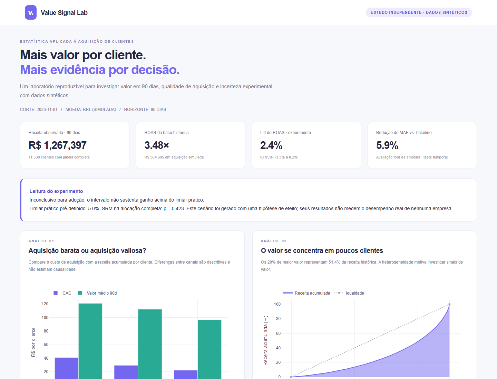

# Value Signal Lab

**Da conversão ao valor: análise estatística de aquisição de clientes em 90 dias.**

Projeto de portfólio em Python: usar valor futuro do cliente para avaliar qualidade de aquisição, além do custo da primeira conversão. O estudo combina análise exploratória, modelo preditivo, calibração e inferência experimental em uma execução reproduzível.

> Todos os dados da demonstração são **sintéticos**. Este é um projeto independente. Resultados simulados não demonstram desempenho comercial real.



## A pergunta de negócio

**Clientes mais baratos de adquirir também geram o melhor retorno em 90 dias?**

O projeto responde em três etapas:

1. **Entender o valor:** distribuição de receita, concentração, coortes e comparação de CAC/ROAS entre Google, Meta e TikTok.
2. **Prever o valor:** estimar receita acumulada de 90 dias usando apenas informações disponíveis na primeira compra; comparar com uma regra simples e validar em clientes adquiridos depois.
3. **Medir a incerteza:** avaliar um experimento sintético com ROAS como métrica primária, bootstrap de pares receita/custo, intervalo de confiança e limiar de ganho relevante.

## Explorar o projeto

| Entrega | Conteúdo |
| --- | --- |
| [Notebook executado](notebooks/01_value_signal_analysis.ipynb) | Raciocínio, tabelas e resultados calculados |
| [Resultados da demo](reports/demo/README.md) | Indicadores de referência gerados pelo pipeline |
| [Relatório interativo](reports/demo/report.html) | Seis visualizações em HTML, disponível offline após baixar |
| [Resumo auditável](reports/demo/summary.json) | Métricas, proveniência, seed, datas e versões |
| [Metodologia](docs/methodology.md) | Estimandos, hipóteses, desenho experimental e limitações |
| [Contrato de dados](docs/data-contract.md) | Colunas, validações e uso com CSV próprio |

O GitHub mostra o código-fonte do HTML. Para interagir com os gráficos, baixe o repositório e abra `reports/demo/report.html` no navegador. Não é necessário servidor ou acesso à internet.

## Executar

Python 3.11 ou superior. Na raiz do projeto, em PowerShell:

```powershell
python -m venv .venv
.\.venv\Scripts\python.exe -m pip install -e ".[dev]"
.\.venv\Scripts\value-signal-lab.exe --output reports/local
Start-Process reports/local/report.html
```

Em Linux/macOS:

```bash
python -m venv .venv
source .venv/bin/activate
python -m pip install -e '.[dev]'
value-signal-lab --output reports/local
```

Uma execução padrão simula 12.000 clientes históricos e 6.000 unidades experimentais, com seed 42 e data de corte fixa em **2026-11-01**. O calendário fixo evita que os resultados mudem apenas pela passagem do tempo.

```bash
# Execução mais curta
value-signal-lab --customers 3000 --bootstrap 200 --output reports/local

# Recriar os resultados completos versionados
value-signal-lab --customers 12000 --seed 42 --bootstrap 2000 --output reports/demo

# Dados próprios: saídas CSV/JSON locais, sem relatório rotulado como simulação
value-signal-lab --historical-csv data/raw/customers.csv --experiment-csv data/raw/experiment.csv --output reports/local

# Validação
pytest -q
ruff check .
```

CSV próprio deve seguir o calendário e as unidades descritos no [contrato](docs/data-contract.md). A pasta `data/raw/` e os resultados `reports/local/` são ignorados pelo Git. Não misture histórico real com experimento sintético. Os comandos não fazem upload de dados.

O [requirements-demo.txt](requirements-demo.txt) registra as versões numéricas usadas na demonstração; o `pyproject.toml` define faixas compatíveis para instalação normal. Há pequenas diferenças numéricas possíveis entre plataformas.

## Decisões estatísticas

- **Janela completa:** somente clientes com 90 dias observados entram na análise do alvo. Coortes incompletas não recebem zeros artificiais.
- **Validação temporal:** treino em 2024, calibração entre abril e junho de 2025, teste entre outubro de 2025 e julho de 2026. Há tempo para os rótulos de 90 dias amadurecerem antes da próxima etapa.
- **Baseline explícita:** primeira compra multiplicada pelo fator de receita aprendido no treino. O modelo deve agregar valor em relação a essa alternativa simples.
- **Calibração separada:** ajuste multiplicativo global aprendido em um bloco próprio. Métricas e decis são calculados em teste intocado.
- **ROAS correto:** razão de somas, e não média de razões individuais. Cada reamostragem preserva a dependência entre receita e custo do cliente.
- **Decisão prática:** o limite inferior do IC de 95% precisa superar 5% para sustentar adoção neste exemplo. Um teste de desequilíbrio de alocação (SRM) precede a interpretação.

Receita de 90 dias é uma aproximação operacional de valor, **não LTV vitalício ou lucro**. O experimento sintético impõe +12% na receita posterior à primeira compra e +2% no custo do tratamento. Isso não equivale a um lift de 12% no ROAS: o efeito final depende da primeira compra, dos custos e do ruído da amostra.

## Organização

```text
src/value_signal_lab/
  data.py          # Simulação, maturidade e validação de dados
  model.py         # Modelo, baseline, calibração e holdout temporal
  experiment.py    # Bootstrap de ROAS, SRM e tamanho amostral
  report.py        # Relatório HTML independente, com Plotly embutido
  cli.py           # Pipeline e interface de linha de comando
notebooks/         # Estudo executado e comentado em português
docs/              # Metodologia, contrato e prévia
reports/demo/      # Artefatos públicos, sempre sintéticos
tests/             # Validação de inferência, dados e execução completa
```

O CI executa lint, testes e uma análise completa reduzida em Python 3.11 e 3.13. Os testes incluem ausência de vazamento do teste para o treino, exclusão de rótulos imaturos, ROAS como razão de somas, preservação dos pares no bootstrap e cenários de efeito nulo/negativo.

## Referências

- [scikit-learn — HistGradientBoostingRegressor](https://scikit-learn.org/stable/modules/generated/sklearn.ensemble.HistGradientBoostingRegressor.html).
- [SciPy — teste de Welch com `ttest_ind`](https://docs.scipy.org/doc/scipy/reference/generated/scipy.stats.ttest_ind.html).
- [SciPy — distribuição normal usada no planejamento](https://docs.scipy.org/doc/scipy/reference/generated/scipy.stats.norm.html).

Licença MIT.
